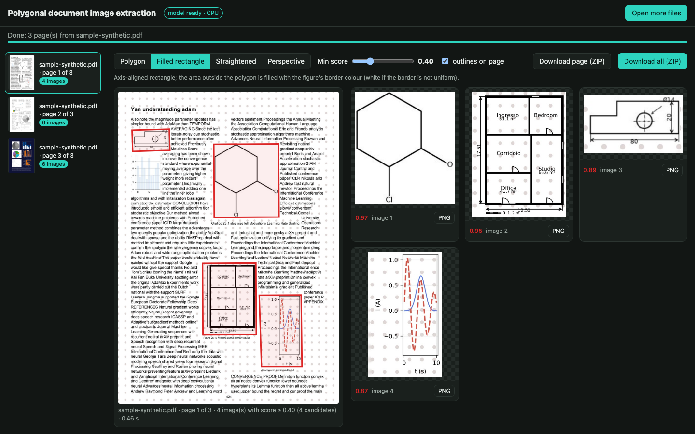
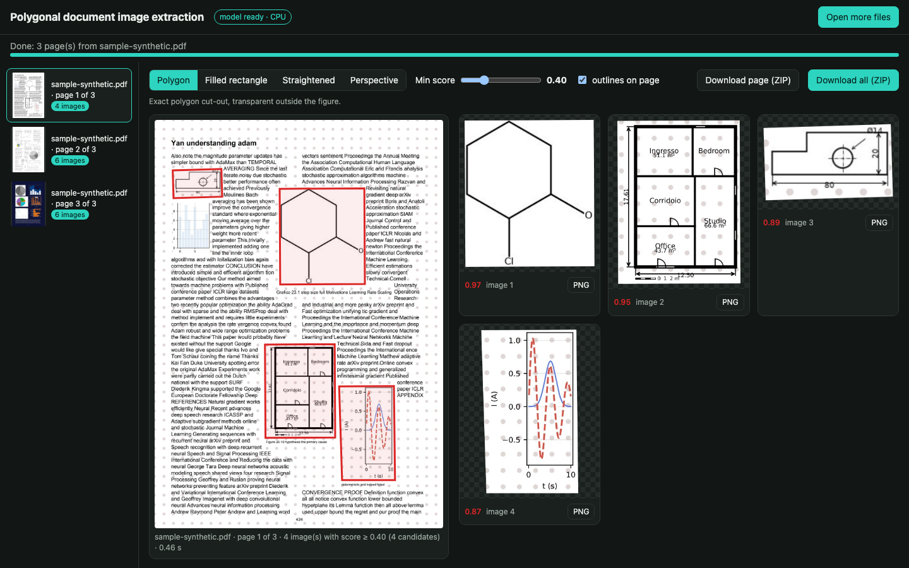

# Polygonal document image extraction

Extract the images, charts, diagrams and drawings contained in **PDF pages and phone photos of documents**, as
**polygons** instead of rectangles, with a small model that runs on a normal laptop CPU.



Most layout detectors return axis-aligned boxes. Real documents are not that tidy: pages are photographed at an
angle, figures are cut-outs that wrap around text, drawings come with arrows and labels around them. PolyDETR, the
model behind this app, predicts a polygon for every figure, so the extraction follows the figure and not its bounding
box.

> **Status: v0.** The model works well on clean digital pages and on many phone photos, and it is still weak on
> infographics, composite figures and confidence calibration on real pages (see [Limitations](#limitations)).
> Later versions (v1, v2, …) will be trained on more varied data and on real annotated pages.

## What it does

1. You open one or more files in the browser: PDFs (multi-page files are split page by page), JPG, PNG, HEIC
   (iPhone photos) or multi-page TIFF.
2. Every page goes through PolyDETR on the CPU, about 0.5 s per page on a recent laptop.
3. The app shows the page with the detected figures outlined, and the extracted images next to it. You choose how
   they are extracted:

| Mode | What you get |
|---|---|
| **Polygon** | The exact polygon, transparent outside the figure (PNG with alpha). |
| **Filled rectangle** | The axis-aligned bounding rectangle; the area outside the polygon is filled with the colour of the figure's own border, or with white when the border is not uniform. The image is not rotated. |
| **Straightened** | Like filled, but the rectangle follows the figure's orientation and is rotated upright. |
| **Perspective** | Figures that are quadrilaterals in a photo (a picture on a page shot at an angle) are rectified with a perspective transform; other shapes fall back to straightened. |

4. A **minimum score** slider (default **0.40**) decides which detections are shown; lower it to see the uncertain
   candidates. Every image can be downloaded as PNG, or all of them as a ZIP, per page or for the whole upload.



## Quick start

You need **Python 3.10 or newer** ([python.org](https://www.python.org/downloads/)) and an internet connection the
first time.

```bash
git clone https://github.com/EnricoSimionato/polygonal-doc-image-extraction.git
cd polygonal-doc-image-extraction
```

Then start the app:

- **macOS**: double-click `run.command` (if macOS blocks it: right click, *Open*, then *Open* again).
- **Linux**: `./run.sh`
- **Windows**: double-click `run.bat`.

The first run creates a virtual environment in `.venv`, installs the requirements (a few minutes) and downloads the
model weights (93 MB) from the [v0 release](https://github.com/EnricoSimionato/polygonal-doc-image-extraction/releases/tag/v0),
checking them against [`weights/SHA256SUMS`](weights/SHA256SUMS). Later runs start in a few seconds and open the
browser by themselves. Close the terminal window to stop the app.

Try it with [`examples/sample-synthetic.pdf`](examples/sample-synthetic.pdf), three synthetic pages with charts,
diagrams, floor plans and technical drawings.

## Privacy and security

- **Nothing leaves your computer.** The app is a local web server bound to `127.0.0.1`; uploaded files and results
  are kept in a temporary folder that is deleted when the app stops.
- Every API call needs a random token generated at start-up and embedded in the page the server serves, and requests
  with a foreign `Host` header are refused, so other web sites open in your browser cannot drive the app.
- The weights are distributed as [safetensors](https://github.com/huggingface/safetensors) (no pickle, loading them
  cannot execute code) and verified with SHA-256 before use.
- Uploads are limited to 200 MB and 300 pages; huge images are refused (decompression-bomb protection).

## How it works

PolyDETR is a DETR-style detector (ResNet-18 backbone, hybrid encoder, 6-layer decoder, 40 queries, 23.2 M
parameters) whose queries output a confidence and a closed contour of 32 points instead of a box; the contour is
simplified into a polygon with few vertices after prediction. It is trained only on **synthetic pages**: real
documents layouts (books, papers, magazines, slides, reports, dashboards) are generated as PDFs, with images, charts,
diagrams, floor plans, technical drawings, cut-outs, figures with callouts and groups of linked images placed among
the text; the ground-truth polygons come for free from the PDF itself. During training the pages are turned into
"phone photos" on the fly: perspective, rotation, lighting, paper textures, occluding fingers and pens, photocopy
effects. Details in the [model card](MODEL_CARD.md).

The rectangular modes are deterministic post-processing ([`app/rectify_figure.py`](app/rectify_figure.py)): the
figure's background is read on the inner border of the polygon (in Lab colour space) and propagated outside it with
inpainting, so a slight gradient in a photographed page continues smoothly; if the border is not uniform the frame is
filled with white.

## Limitations

v0 has been evaluated on synthetic validation pages and inspected by eye on real pages; there is no annotated
real-world benchmark yet.

- **Infographics and composite figures** (pictograms, small charts, text boxes and arrows forming one figure) are
  often split into several pieces.
- **Arrows that are not part of a figure** (arrow-shaped bullet points, decorative arrows) can be absorbed into a
  nearby figure, and two images close to each other can be merged.
- **Confidence on real pages is lower than on synthetic ones**: simple line drawings embedded in dense pages may score
  below 0.5, which is why the default threshold is 0.40.
- Large empty areas of a page are occasionally taken for images.
- Tables are not a target class; tables embedded as pictures may be extracted.

## Repository layout

```
app/              local web app: server.py (Flask), extraction.py, static/index.html
app/polydetr/     model code (inference)
app/rectify_figure.py   rectangular completion of extracted polygons
weights/          model configuration and checksum (the weights come from the release)
examples/         a synthetic sample PDF
attribution/      sources and licenses of the images used to generate the training data
```

## Versions

| Version | Date | Notes |
|---|---|---|
| **v0** | 2026-10 | First public model and local app. See [CHANGELOG.md](CHANGELOG.md). |

## License

- **Code**: [Apache License 2.0](LICENSE).
- **Model weights** (`polydetr-v0.safetensors`): [CC BY-SA 4.0](https://creativecommons.org/licenses/by-sa/4.0/), because
  part of the images used to synthesise the training pages are under share-alike licenses. See
  [MODEL_CARD.md](MODEL_CARD.md) and [ATTRIBUTION.md](ATTRIBUTION.md).
- The ResNet-18 backbone was initialised from [`timm/resnet18.a1_in1k`](https://huggingface.co/timm/resnet18.a1_in1k)
  (Apache-2.0).
